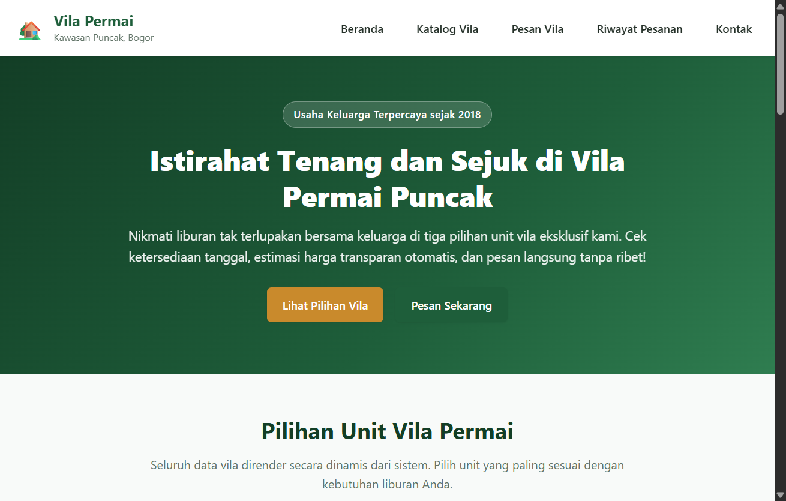
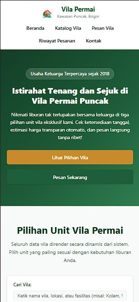
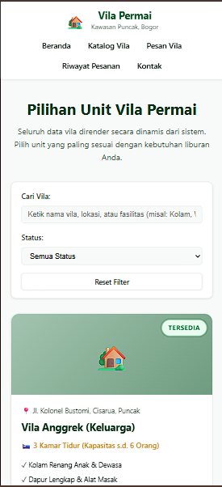
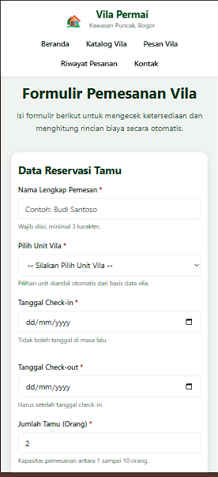
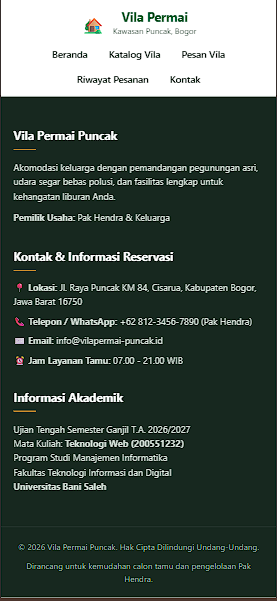

# UTS Teknologi Web - Aplikasi Pemesanan Vila Permai

Repository publik untuk pengumpulan Ujian Tengah Semester (UTS) Ganjil Tahun Akademik 2026/2027.

- Mata Kuliah: Teknologi Web (200551232)
- Dosen Pengampu: Rahmadi, S.Kom., M.Kom.
- Program Studi: Manajemen Informatika
- Fakultas: Teknologi Informasi dan Digital, Universitas Bani Saleh

---

## Identitas Mahasiswa

- Nama Mahasiswa: Raihan Nur Falah
- NIM: 24011130492
- Kelas: MI5BP
- Nama Repository: uts-vila-permai-24011130492
- Tautan Repository: https://github.com/hancokro911/uts-vila-permai-24011130492
- Tautan GitHub Pages: https://hancokro911.github.io/uts-vila-permai-24011130492/

---

## Deskripsi Singkat

Website pemesanan tiga unit vila milik Pak Hendra di kawasan Puncak berbasis client-side (HTML, CSS, dan JavaScript). Aplikasi ini membantu calon tamu mengecek ketersediaan vila, menghitung durasi malam dan total biaya sewa secara otomatis sebelum memesan, serta menyimpan riwayat pesanan secara lokal tanpa menggunakan server maupun database.

---

## Fitur Utama

- Struktur Semantik HTML5: menggunakan header, nav, main, section, article, dan footer secara berjenjang.
- Desain Responsif: tampilan CSS eksternal dengan media query (layar tablet max 768px dan ponsel max 480px).
- Render Data Dinamis: daftar 3 unit vila dirender dari array objek JavaScript menggunakan createElement dan appendChild.
- Hitung Total Otomatis: kalkulasi durasi malam dan total harga sewa terhitung real-time sebelum submit.
- Validasi Input Bahasa Indonesia: pengecekan nama, tanggal check-in/out, dan jumlah tamu (1-10 orang).
- Pencarian dan Filter: filter unit vila berdasarkan kata kunci pencarian dan status ketersediaan.
- Penyimpanan Lokal (localStorage): menyimpan nama tamu terakhir dan daftar riwayat pesanan di browser.

---

## Status Fitur

| Kategori | Fitur | Status | Keterangan |
| :--- | :--- | :---: | :--- |
| HTML | Struktur dokumen valid HTML5 dan semantik | Selesai | Menggunakan header, nav, main, section, article, footer |
| HTML | Form pemesanan lengkap dan dropdown dinamis | Selesai | Pilihan vila otomatis dari array data |
| CSS | Stylesheet eksternal, Box Model, dan 2 Breakpoint | Selesai | Layout responsif desktop, tablet, dan ponsel |
| CSS | Efek hover, transisi, dan animasi keyframes | Selesai | Interaktif pada kartu dan tombol |
| JavaScript | Render dinamis DOM (createElement/appendChild) | Selesai | Tidak memakai innerHTML statis |
| JavaScript | Kalkulasi otomatis durasi dan total harga | Selesai | Tampil otomatis sebelum tombol ditekan |
| JavaScript | Validasi form berbahasa Indonesia | Selesai | Pesan kesalahan informatif dan ramah |
| JavaScript | Filter pencarian dan tombol cek ketersediaan | Selesai | Filter real-time |
| JavaScript | Penyimpanan riwayat pesanan (localStorage) | Selesai | Data tersimpan saat reload halaman |
| Git | Minimal 4 commit bermakna | Selesai | Sesuai instruksi soal |
| Bonus | Branch tambahan (fitur/filter-pencarian) dan tag v1.0 | Selesai | Sudah ter-push ke GitHub |
| Bonus | Halaman live via GitHub Pages | Selesai | Siap diakses publik |
| Pengembang | Integrasi gateway pembayaran online | Belum | Rencana pengembangan lanjutan |

---

## Cara Menjalankan

1. Clone repository ini:
   ```bash
   git clone https://github.com/hancokro911/uts-vila-permai-24011130492.git
   ```
2. Buka folder `uts-vila-permai`.
3. Buka file `index.html` langsung dengan klik dua kali di browser (Chrome, Edge, atau Firefox), atau gunakan ekstensi Live Server di VS Code.

---

## Tangkapan Layar (Screenshot)

### 1. Tampilan Desktop


### 2. Tampilan Responsif Mobile
| Beranda | Katalog & Filter | Form Pemesanan | Footer & Kontak |
| :---: | :---: | :---: | :---: |
|  |  |  |  |

---

## Struktur File

```text
uts-vila-permai/
├── .gitignore
├── README.md
├── index.html
├── style.css
├── script.js
├── JAWABAN_BAGIAN_C.md
└── screenshot/
```
